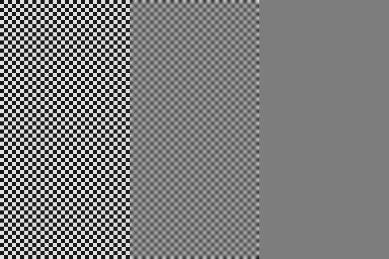
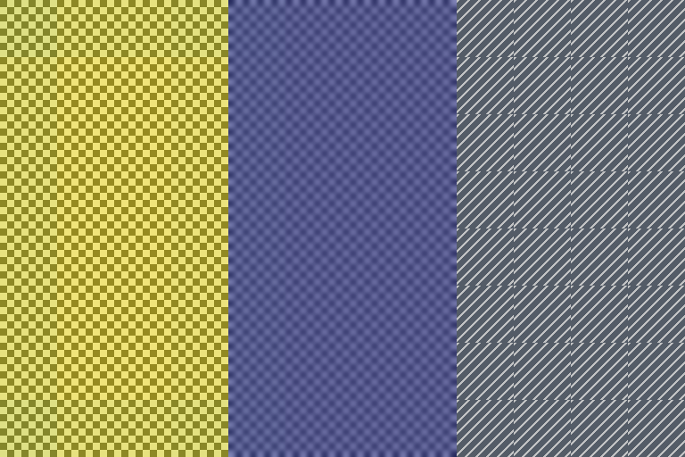
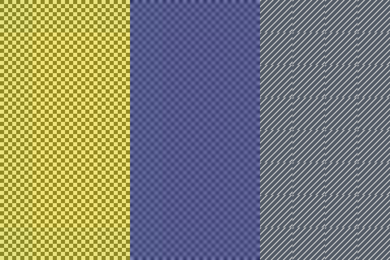

# Laplacian Blur Detector


A reusable image-sharpness library, command-line tool, and optional HTTP service.
The project is an open-source image quality toolkit that others can use, integrate,
and contribute to. Vehicle photos are one use case alongside document capture,
product photography, and other image upload workflows.

**Public version: [v0.3.0a1 — Experimental Pre-release](https://github.com/yyyunx/laplacian-blur-detector/releases/tag/v0.3.0a1).**
Use trusted images in a bounded local environment only. This is not Production
Ready; public unauthenticated HTTP hosting is not recommended. Container
advisories, including libxml2, remain; see [security caveats](SECURITY-CAVEATS.md).
The Python core measures
Laplacian variance, Tenengrad, and local grid sharpness with an interactive relative
heatmap. The benchmark can compare metrics using independent thresholds. The
single-image CLI, batch decisions, and default benchmark retain the original
Laplacian variance calculation.
Optional quality diagnostics add encoded brightness, exposure ratios, resolution,
and configurable improvement hints. They do not accept/reject images or replace
the existing batch threshold decisions.
It is not a learned model or a complete image quality assessment. Use the browser
tool, CLI, or API directly; accounts and manually labeled datasets are not required.

## Five-minute quick start

Use Python 3.10+. No repository clone is needed for the released package.
From [GitHub Releases](https://github.com/yyyunx/laplacian-blur-detector/releases/tag/v0.3.0a1),
download the [Wheel](https://github.com/yyyunx/laplacian-blur-detector/releases/download/v0.3.0a1/laplacian_blur_detector-0.3.0a1-py3-none-any.whl)
and [SHA256SUMS](https://github.com/yyyunx/laplacian-blur-detector/releases/download/v0.3.0a1/SHA256SUMS)
into a new folder. Run the commands below from that folder. Compare the printed
Wheel hash with its line in SHA256SUMS **before installing**.

### Windows PowerShell

```powershell
Get-FileHash .\laplacian_blur_detector-0.3.0a1-py3-none-any.whl -Algorithm SHA256
python -m venv .venv
.\.venv\Scripts\python.exe -m pip install "./laplacian_blur_detector-0.3.0a1-py3-none-any.whl[server]"
.\.venv\Scripts\laplacian-blur-serve.exe
```

These commands use the venv executables directly; PowerShell activation is optional.

### Linux / macOS

```bash
# Linux (on macOS use: shasum -a 256 laplacian_blur_detector-0.3.0a1-py3-none-any.whl)
sha256sum laplacian_blur_detector-0.3.0a1-py3-none-any.whl
python3 -m venv .venv
./.venv/bin/python -m pip install "./laplacian_blur_detector-0.3.0a1-py3-none-any.whl[server]"
./.venv/bin/laplacian-blur-serve
```

Use the macOS hash command instead of `sha256sum` there. NumPy/OpenCV need
compatible native wheels/system libraries. CI covers Windows/Ubuntu Python
3.10/3.12/3.13; these macOS shell instructions are not a macOS/ARM certification.
An sdist is also available on the Release page. This version is distributed on
GitHub Releases; no PyPI publication is implied.

### First try

Open [the local tool](http://127.0.0.1:8000), select **Try generated demo**, then
**Heatmap**. Switch metrics, adjust opacity, and inspect regions. Batch decisions
remain independent. Select **Measure quality** for brightness/exposure/resolution
and both sharpness metrics. Stop the local server with Ctrl+C.

For optional saved CLI examples, run the venv's `laplacian-blur-demo` command
with `--output outputs/my-first-demo`. It writes six synthetic stress cases, separate
calibration/test captures, frozen per-metric policies, original/heatmap PNGs, and
`comparison/comparison.csv`, `comparison.json`, and `metric-comparison.svg`.
Open the SVG to compare held-out metrics and single-pass latency. Choose a new
output directory for another run; existing artifacts are preserved.

Select **Measure quality** for brightness/exposure/resolution and both sharpness
metrics. Under **Diagnostic policy**, explicitly load uncalibrated example hints
or edit your own bounds, then measure again. Defaults provide measurements only.

| Original | Relative Laplacian | Relative Tenengrad |
| --- | --- | --- |
|  |  |  |

These are static outputs from the numeric core, **not browser screenshots**.
Hatching identifies low texture. See the [recorded synthetic experiment](docs/EXPERIMENTS.md)
for the actual comparison chart, measured results, and failure cases, and the
[validation record](docs/VALIDATION.md) for checks performed and browser limitations.
Synthetic labels are generation rules, not human judgments or evidence of
real-world accuracy. No trained model or real-image accuracy improvement is claimed.

Read the [release record and remaining limits](docs/RELEASE_READINESS.md),
[actual resource costs](docs/PERFORMANCE.md), [integration examples](docs/INTEGRATION.md)
and [maintainer browser acceptance](docs/BROWSER_QA.md). On 2026-11-23 the maintainer
reported manual browser QA passed for the listed scope; this was not a Codex
browser run. Missing browser/build/touch evidence is recorded. This is a
published Experimental Pre-release for trusted images in a bounded local setup,
with unresolved container advisories. PR #1–#6 are merged; see the
[integration record](docs/INTEGRATION_PLAN.md) and
[versioned attachment/install instructions](docs/PRERELEASE_PREPARATION.md).

## Choose how to use it

| Interface | Useful for |
| --- | --- |
| Python library | Integrating measurements into your own application |
| Single-image CLI | Checking an image locally |
| Dataset CLI with CSV | Inspecting score distributions across a folder |
| Browser tool and optional API | Checking batches, exporting results, and connecting another backend |
| Multi-metric benchmark and demo | Independent calibration, frozen-policy replay, and reproducible comparisons |

No images are persisted by the API. The browser previews selected images locally
and uploads them only when analysis is requested. HTTP uploads may use temporary
spooled files while a request is processed; these are closed after the request.
Browser exports and the dataset CLI write CSV only when requested.

## Developer installation (source checkout)

For contributions or source integrations, use Python 3.10+ and clone the repository.
Use the `v0.3.0a1` tag instead of main when you need the published source exactly.

```bash
git clone https://github.com/yyyunx/laplacian-blur-detector.git
cd laplacian-blur-detector
python -m venv .venv
```

Activate the environment:

```powershell
# Windows PowerShell
.venv\Scripts\Activate.ps1
```

```bash
# macOS / Linux
source .venv/bin/activate
```

Choose the dependencies you need:

```bash
# Library and image/dataset CLI only
python -m pip install .

# Add the API and browser demo
python -m pip install ".[server]"

# Editable contributor setup, including API, tests, lint, and builds
python -m pip install -e ".[server,dev]"
```

These commands install from this checkout; a PyPI release is not assumed.
`python -m pip install -r requirements.txt` remains available for the complete
server/development setup. Runtime and development dependencies are declared in
`pyproject.toml`; the core library does not require FastAPI or Uvicorn.

## Python library

```python
from laplacian_blur_detector import calculate_blur_score, detect_blur
from laplacian_blur_detector.image_utils import load_image

image = load_image("sample.jpg")
score = calculate_blur_score(image)
result = detect_blur(image, threshold=100)
print(score, result)
```

The calculation is `cv2.Laplacian(gray, cv2.CV_64F).var()`. Higher scores generally
indicate more edge detail. `is_blurry` is true when the score is below the threshold;
a score exactly equal to the threshold passes. This score is not a percentage or
confidence value, and passing the threshold does not establish overall image quality.

### Compare core sharpness metrics

```python
from laplacian_blur_detector import (
    calculate_sharpness, calculate_tenengrad_score, analyze_local_sharpness,
)

laplacian = calculate_sharpness(image, metric="laplacian")
tenengrad = calculate_tenengrad_score(image)
# Equivalent: calculate_sharpness(image, metric="tenengrad")

cells = analyze_local_sharpness(image, grid_size=(8, 8), metric="tenengrad")
for cell in cells:
    print(cell["x"], cell["y"], cell["width"], cell["height"],
          cell["sharpness_score"], cell["is_low_texture"])
```

| Metric | Definition | Main limitations |
| --- | --- | --- |
| `laplacian` | Variance of the grayscale Laplacian response; same definition as `calculate_blur_score()` | Sensitive to noise, contrast, content, and resizing |
| `tenengrad` | Mean of `Sobel_x² + Sobel_y²`, using unscaled 3×3 Sobel kernels | Measures gradient energy; noise and high contrast can also raise the score |

**Scores from different metrics cannot be compared directly.** Neither is a
percentage or confidence value. Do not reuse a Laplacian threshold for Tenengrad.
Keep intensity scale, resolution, preprocessing, and content comparable when
comparing the same metric; intensities are not normalized automatically.

Local analysis defaults to 8 rows × 8 columns; `grid_size=4` means 4×4, and
`grid_size=(3, 5)` means 3 rows × 5 columns. Cells are returned in row-major order
with zero-based pixel coordinates. Remainder pixels are included; grids larger
than the image dimensions are rejected. Derivatives are computed on the full
image before cell statistics, so grid boundaries introduce no artificial
reflection gradients. The outer image border still uses OpenCV reflection.

Each cell also reports grayscale `texture_std` and `is_low_texture`, true when
`texture_std <= min_texture_std` (default `5.0`, in native intensity units,
intended for 0–255 images). Low texture provides insufficient evidence to infer
blur. The marker is a heuristic: a heavily blurred region may also have low
texture, and an unflagged region is not guaranteed sharp. Local analysis returns
measurements and flags, with no `is_blurry` classification. Adjust the texture
cutoff for normalized float or 16-bit images and calibrate any downstream policy
on representative images.

The core requires only NumPy/OpenCV. See the [API reference](docs/API.md) for signatures, supported
arrays, output fields, and error behavior. Existing HTTP fields, CLI output,
benchmark policies, and `detect_blur()` decisions remain unchanged.

## Image quality diagnostics

Image quality diagnostics are available as an independent Python core:
`measure_image_quality(image)` returns brightness, exposure, resolution and both
sharpness metrics; `diagnose_image_quality(image, policy)` adds opt-in hints.
Default warning rules are disabled. See [diagnostic policy and limitations](docs/DIAGNOSTICS.md).

The same image page includes a **Quality diagnostics** panel with numeric
measurements, warnings/evidence, improvement suggestions and definitions. Low
texture is insufficient evidence, not a rejection. The example policy is
explicitly uncalibrated; it uses 1024×768 as an illustrative minimum, so the
768×512 generated preview demonstrates a resolution hint. Use task-specific
bounds rather than treating this example as a universal quality rule.

`POST /api/quality/diagnose` accepts `image` plus an optional JSON `policy` form
field. It shares existing validation/resource limits and applies EXIF orientation
before resolution checks. Other API, CLI, benchmark, heatmap and batch behavior
remain compatible. No real-image accuracy improvement is claimed.

## Command line

```bash
laplacian-blur sample.jpg --threshold 120
laplacian-blur-evaluate ./samples --output ./outputs/blur_scores.csv
```

Single-image output includes resolution, score, threshold, and CLEAR/BLURRY.
Dataset evaluation scans JPG/JPEG/PNG files recursively, reports unreadable files,
and exports `filename`, `width`, `height`, `file_size`, `blur_score`, `threshold`,
and `is_blurry`. Source images are not modified. By default the CSV is written to
`outputs/blur_scores.csv` relative to the current working directory.

Existing checkout commands remain supported:

```bash
python scripts/test_image.py sample.jpg --threshold 120
python scripts/evaluate_dataset.py ./samples
```

## Browser tool and API

Install the `server` extra, then run:

```bash
laplacian-blur-serve
```

Open the demo at <http://127.0.0.1:8000>, interactive API documentation at
<http://127.0.0.1:8000/docs>, or health check at <http://127.0.0.1:8000/healthz>.
Use `--host` and `--port` to choose the listener. The existing checkout command
`uvicorn api.main:app --host 127.0.0.1 --port 8000` also works.

Choose or drag in up to 20 JPG/JPEG/PNG images, then select **Analyze pending**.
The queue shows progress and keeps individual errors alongside successful results.
Select a filename to inspect its preview, metadata, score, and raw response.

- Filter by clear, blurry, failed, or pending; sort by filename or score.
- Cancel remaining work and resume pending images. Already completed results stay.
- Retry failed uploads without repeating successful ones.
- Export the entire queue as CSV, including failed and pending rows, in the chosen
  sort order. The filter does not remove rows from the export.
- Enter any finite non-negative threshold. Changing it invalidates previous results
  so the screen never presents decisions made with an older threshold as current.

Each browser request analyzes one image, with a 30-second client timeout. Canceling
stops further requests; work already accepted by the server may finish. No login
or image labeling is needed.

### Interactive local heatmap

Select a filename, then select **Heatmap** in the **Relative Sharpness** panel.
This sends that image to the independent local-analysis endpoint; batch analysis
is not required first. Switch **Laplacian / Tenengrad**, set rows and columns,
and adjust **Opacity**. Hover or tap a cell for its pixel coordinates, raw score,
texture standard deviation, and low-texture status. Keyboard users can focus the
map and inspect cells with arrow keys. **Original** restores the uncolored preview.

The blue → teal → yellow ramp maps the minimum/maximum raw scores of cells above
the texture cutoff in this image to lower/higher relative values. Low-texture
cells use a separate gray/white hatch and do not set the color range. Equal
textured scores use the midpoint color; an entirely low-texture image has no
color range. These are **Relative Sharpness** values, not standardized scores
that can be compared across images or metrics. Colors do not locate true blur.

HTTP grids are limited to 1–32 rows/columns (at most 1,024 cells), with each cell
at least 16×16 pixels. The 8×8 default therefore requires at least 128×128 pixels;
use a smaller grid for small images. The Python library retains its unrestricted
grid behavior. Texture cutoff defaults to `5.0` in native grayscale units and
should be adjusted for full-range 16-bit images. JPEG EXIF orientation is applied
to local measurements to align coordinates with browser previews.

Metric/grid/cutoff changes refresh only the local map. Switching files clears it;
late responses cannot overwrite the new preview. Original/Heatmap toggles and
opacity changes reuse the current result. Batch analysis takes priority over
pending local work; queue filters, sorting, retry, cancellation, and CSV retain
their original behavior. Batch CSV still exports whole-image Laplacian results.

For a reproducible local demo, from the repository root:

```powershell
.venv\Scripts\python.exe examples/create_sharpness_demo.py
.venv\Scripts\python.exe -m uvicorn api.main:app --host 127.0.0.1 --port 8000
```

Open [the local demo](http://127.0.0.1:8000), select **Try generated demo** (or
choose `outputs/sharpness-demo.png`), set 8 rows × 12 columns, then select **Heatmap**.
The fixture has a crisp pattern on the left, a Gaussian-softened pattern in the
middle, and flat content on the right. Try both metrics and the opacity slider;
the flat panel is hatched rather than classified as blurry. This fixture checks
visual behavior and is not an accuracy benchmark.

### POST /api/sharpness/local

Accepts multipart `image`, optional `metric` (`laplacian` or `tenengrad`),
`grid_rows`/`grid_columns` (default `8`), and `min_texture_std` (default `5.0`).
Returns image metadata, selected settings, and row-major `cells` with coordinates,
raw scores, and texture information. No blur classification or normalized score
is returned. It uses the same file/header/pixel/request limits and bounded worker
slots as the existing endpoints. See the [local HTTP contract](docs/API.md#local-http-api)
for response fields, limits, and error codes.

```bash
curl -X POST http://127.0.0.1:8000/api/sharpness/local -F "image=@sample.jpg" -F "metric=tenengrad" -F "grid_rows=8" -F "grid_columns=8"
```

### POST /api/blur/check

Accepts multipart fields `image` and optional `threshold` (default `100.0`).

```bash
curl -X POST http://127.0.0.1:8000/api/blur/check -F "image=@sample.jpg" -F "threshold=120"
```

On Windows PowerShell, use `curl.exe` if `curl` is a shell alias.

```json
{
  "success": true,
  "filename": "sample.jpg",
  "width": 1280,
  "height": 720,
  "file_size": 862208,
  "blur_score": 184.72,
  "threshold": 120.0,
  "is_blurry": false,
  "message": "Image passes the sharpness threshold."
}
```

The message currently reflects only the blur threshold. Empty, undecodable, or
unsupported uploads and invalid non-negative finite thresholds return an error.
`GET /healthz` returns `{"status": "ok"}`.

### POST /api/blur/batch

Accepts repeated multipart `images` fields and optional `threshold`. Results keep
input order, including when filenames repeat. A bad file does not discard other results.

```bash
curl -X POST http://127.0.0.1:8000/api/blur/batch -F "images=@one.jpg" -F "images=@two.png" -F "threshold=120"
```

The response includes `total`, `processed` (successfully analyzed), `failed`, `clear`,
`blurry`, `threshold`, and `results`. Top-level `success` is false if any file failed.
Each successful row has the same fields as the single-image response, including
`processing_ms`. Failed rows contain `filename`, `success: false`, `status_code`,
`error_code`, and `message`. File-level failures use HTTP 200 for the overall batch;
invalid whole requests use an HTTP error.

### Service limits and errors

`GET /api/config` exposes the limits used by the browser:

| Limit | Default |
| --- | --- |
| Encoded size per file | 10 MiB |
| Pixels per image | 20,000,000; checked from the header before OpenCV decoding |
| Files per batch API request or browser queue | 20 |
| Combined image bytes per batch API request | 50 MiB |
| Active decodes/analyses per server process | 2 |

The browser sends sequential single-image requests, so its queue does not need to
fit into one 50 MiB multipart request. The server counts incoming body bytes even
without `Content-Length`; single/batch requests allow 1 MiB of multipart overhead
above their respective byte limit. Server processing runs in worker threads.
Supported content is still JPEG or non-animated PNG even if a file is renamed.

| Status | Meaning |
| --- | --- |
| 400 | Invalid image, unsupported format, invalid threshold, or too many batch files |
| 413 | File, dimensions, total batch, or entire request exceeds a limit |
| 422 | Missing or invalid multipart form fields |
| 503 | Analysis slots are busy; retry using the `Retry-After` hint |

Service validation errors retain the `detail` message and add `error_code`. These
bounds do not add authentication, per-client rate limits, or deployment timeouts;
see [SECURITY.md](SECURITY.md) for deployment boundaries.

## Calibration and domain-specific use

`100.0` is a development default, not a universal acceptance rule. Validate using
representative cameras, resolutions, compression levels, lighting, and subject
sizes for your use case. Record preprocessing and thresholds alongside results.

Laplacian variance measures edge detail. Noise and textured backgrounds can affect
scores; low-detail surfaces, low light, exposure problems, local blur, and small
subjects need separate evaluation. The current implementation does not normalize
resolution or color depth, select a subject region, or correct EXIF orientation.

Keep domain rules outside the measurement core. A document-scanning application
and a vehicle inspection application may use the same score with different quality
policies. For future iRent integration, a backend can call the same API before
accepting an upload; there is no dependency on iRent code.

## Contributing and project direction

Start with [CONTRIBUTING.md](CONTRIBUTING.md). Bug reports and feature proposals
have templates, and pull requests should explain resulting behavior and validation.

- [Roadmap](docs/ROADMAP.md): usability, batch processing, stability, integration,
  and additional quality checks.
- [Architecture](docs/ARCHITECTURE.md): public interfaces and extension boundaries.
- [Changelog](CHANGELOG.md): behavior and compatibility changes.
- [Security policy](SECURITY.md): reporting and deployment boundaries.

Collaboration here means contributing code, documentation, integrations, and
reproducible fixes through GitHub. The product roadmap focuses on the image tool.

## Optional developer benchmarking

Contributors can optionally compare the detector with human judgments. This is
not required to use the image checker. Label a dataset with `filename,label,split,group,domain` (optional `reason`), then run:

```bash
laplacian-blur-benchmark data/labels.csv --calibrate --output outputs/experiment-01
laplacian-blur-benchmark data/new-labels.csv --policy outputs/experiment-01/policy.json --output outputs/experiment-02
laplacian-blur-benchmark data/labels.csv --compare --calibrate --output outputs/metric-comparison
laplacian-blur-benchmark data/labels.csv --metric tenengrad --calibrate --output outputs/tenengrad
```

Thresholds are selected per domain using calibration samples only. Held-out test
reports include false rejections, missed retakes, confusion counts, and an error
list. Reports preserve policy, preprocessing, dataset fingerprints, and runtime
versions, and refuse to overwrite previous runs. Capture-group and duplicate-image
checks help catch calibration/test overlap.

`--compare` runs the existing benchmark once per metric, with independent
thresholds and policies, then writes comparison CSV/JSON and an SVG chart.
`--compare --policy outputs/metric-comparison` replays both frozen policies.
`--metric tenengrad` requires its own explicit threshold, calibration, or frozen
policy; the original default of Laplacian with threshold 100 is preserved.
Summary metrics include balanced accuracy, retake precision/recall/F1, false
reject/missed retake rates, and decode-plus-measurement latency. Missing class
denominators are reported as null. The legacy `blur_score` CSV column holds the
selected metric's raw value; it is not a shared score scale.

See [the benchmarking guide](docs/BENCHMARKING.md) for the CSV format, objective,
limitations, and a runnable synthetic document/product dataset example. Human
labels and real representative data are needed to assess accuracy.

## Validation and packaging

```bash
python -m ruff check .
python -m pytest -q
python -m build
node --test tests/web/*.test.mjs
```

CI is configured to run on Ubuntu and Windows with Python 3.10, 3.12, and 3.13.
It lints, runs regression tests, builds the source distribution and wheel, and
checks the installed CLI/API/assets outside the checkout. GitHub branch protection,
required reviews, and publishing remain maintainer configuration tasks.

See the contribution guide for installed-wheel verification and release steps.

## Docker

```bash
docker build -t laplacian-blur-detector .
docker run --rm --cap-drop=ALL --security-opt no-new-privileges:true --memory=1536m --cpus=2 --pids-limit=128 --read-only --tmpfs /tmp:rw,noexec,nosuid,size=64m -p 127.0.0.1:8000:8000 laplacian-blur-detector
```

The image installs the server extra and includes the browser tool and upload
limits. Containerization does not add authentication or per-client rate limiting.
The example binds only to local loopback, drops Linux capabilities and prevents
setuid/file-capability privilege gains. It does not patch native libraries or make
untrusted images safe. See [targeted container triage](docs/CONTAINER_TRIAGE.md).

## License

Original project code is [MIT licensed](LICENSE). Dependencies keep their own
licenses; see [THIRD_PARTY_NOTICES.md](THIRD_PARTY_NOTICES.md).
