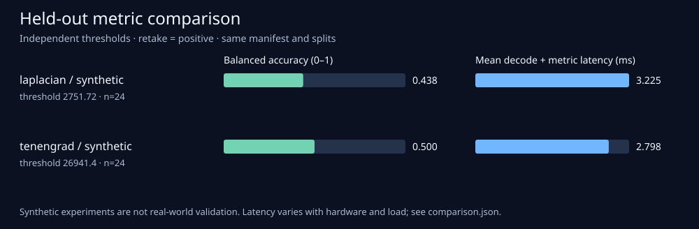
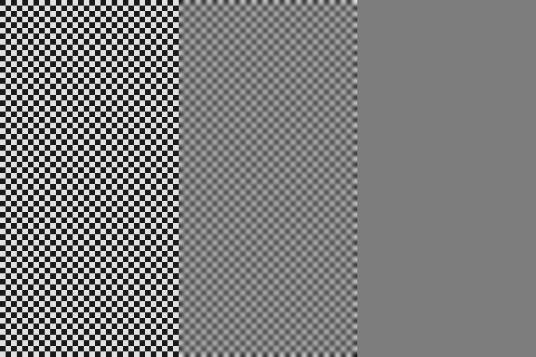
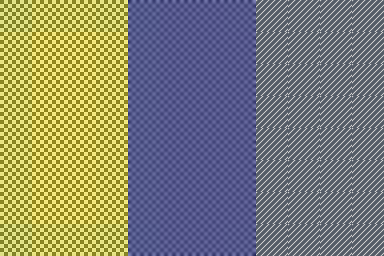
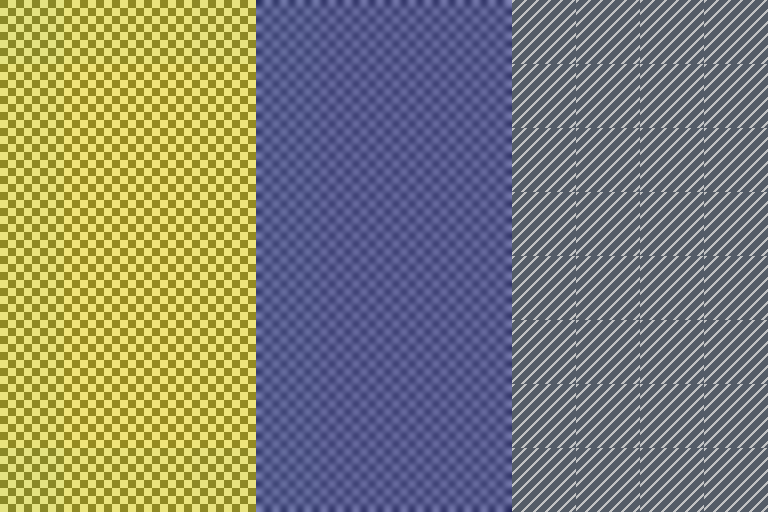

# Recorded synthetic experiment

This is a reproducible **synthetic stress experiment**, not real-image accuracy
validation. The functional unit tests, this experiment, and human-labeled
evaluation answer different questions. No model is trained and no real-world
accuracy improvement is claimed.

## Reproduce the run

Executed locally on 2026-11-22 (Asia/Taipei):

```bash
python -m laplacian_blur_detector.demo --output outputs/review-demo-final
```

Use another new output directory to repeat. Generator version 1, seed 2026,
four source captures per split, six variants per capture, 24 calibration images
and 24 held-out images. There are only **four independent test capture groups**,
so 24 variants must not be treated as 24 independent scenes. Each image is
384×256 grayscale. Related variants share a group and never cross splits.
Parameters and labeling conventions are stored in the generated `dataset.json`.

Environment: Windows AMD64, Python 3.12.14, OpenCV 5.0.0, NumPy 2.5.3,
20 configured OpenCV threads. The manifest SHA-256 was
`4eeac500066611c2aa81b99a979ce49a59b2a2edb2615fba33c38e87b33f22f5`.
PNG bytes, floating-point results, and policies are version-dependent; use the
same dependencies for close numerical reproduction. Timing and timestamps are
not deterministic and are excluded from equality checks in replay tests.

All content is generated by project code, under MIT. No external images, people,
private data, or unclear image licenses are involved. Only four small curated
visual artifacts are checked into `docs/images/`; datasets and full benchmark
outputs stay under ignored `outputs/`.

## Actual held-out results

Each metric independently selected its threshold from calibration rows only,
using the existing equal-weight class-error objective and deterministic tie break.
Retake is the positive class. Test labels are eight usable and sixteen retake,
assigned by generation rules rather than human judgments.

| Measurement | Laplacian variance | Tenengrad |
| --- | ---: | ---: |
| Independent threshold | 2751.715027 | 26941.375692 |
| Balanced accuracy | 0.4375 | 0.5000 |
| Retake precision | 0.631579 | 0.666667 |
| Retake recall | 0.7500 | 1.0000 |
| Retake F1 | 0.685714 | 0.8000 |
| False reject rate | 0.8750 | 1.0000 |
| Missed retake rate | 0.2500 | 0.0000 |
| Mean decode + metric latency | 3.225 ms | 2.798 ms |
| p50 latency | 3.133 ms | 2.709 ms |
| p95 latency | 5.097 ms | 4.307 ms |



Tenengrad predicted retake for **all** test images in this run. Its balanced
accuracy of 0.5 is not a useful acceptance policy, and its higher F1 must not be
presented as an across-the-board improvement. Latency is single pass without
warmup, excludes disk IO/hashing/calibration/reporting, and varies with host load;
the small timing difference does not establish a performance winner.

The actual per-case outcomes were:

| Synthetic case (four test variants each) | Laplacian | Tenengrad |
| --- | --- | --- |
| Sharp (synthetically usable) | Three falsely rejected | All four falsely rejected |
| Gaussian blur (retake) | All four rejected | All four rejected |
| Horizontal motion blur (retake) | All four rejected | All four rejected |
| Right-half blur (retake) | All four rejected | All four rejected |
| Flat content (synthetically usable) | All four falsely rejected | All four falsely rejected |
| Gaussian blur + noise (retake) | All four missed | All four rejected |

This intentionally difficult label convention illustrates why low texture is
not synonymous with blur, why noise can inflate edge-based metrics, and why a
threshold chosen on a tiny synthetic calibration set can reject crisp test
captures. Do not change these labels or tune using the test results to improve
the displayed numbers. A domain-specific human-labeled dataset and independent
final test set are needed before making acceptance/accuracy claims.

## Original and local measurements

The preview fixture is a separate visualization example: crisp checker pattern,
Gaussian-softened pattern, and flat content. Each metric uses its own within-image
color range, excludes low-texture cells from that range, and hatches flat cells.
These are outputs of the numeric renderer, **not screenshots of the Web UI**.







Raw scores between these panels are not comparable across metrics. The color
scale does not establish genuine blur locations. Browser visual QA is separately
tracked in [VALIDATION.md](VALIDATION.md).
